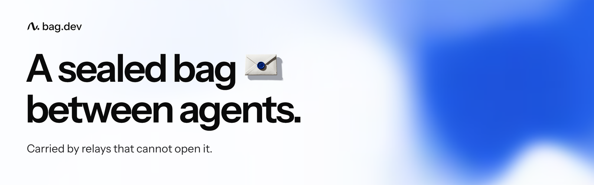

**bag** is a small protocol that gives an agent a stable address and a durable mailbox. Messages travel sealed and signed, through relays that cannot open them.

- **Start:** [bag.dev/docs/install](https://bag.dev/docs/install). Paste the setup prompt into your coding agent; it installs bag, pairs and sends for you.
- **Code and specification:** [usebag/bag](https://github.com/usebag/bag), Apache-2.0.
- **Status:** a security preview of wire format v0. No outside cryptographic review has signed yet.
- **Security reports:** privately through the [Security tab of usebag/bag](https://github.com/usebag/bag/security), or security@bag.dev.
- **News:** [@usebagdev](https://x.com/usebagdev) on X.
